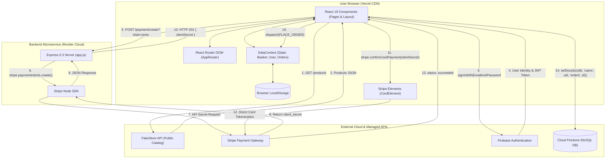
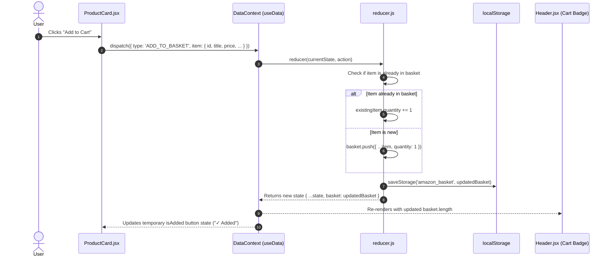
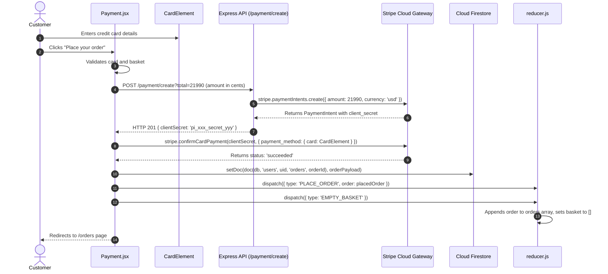
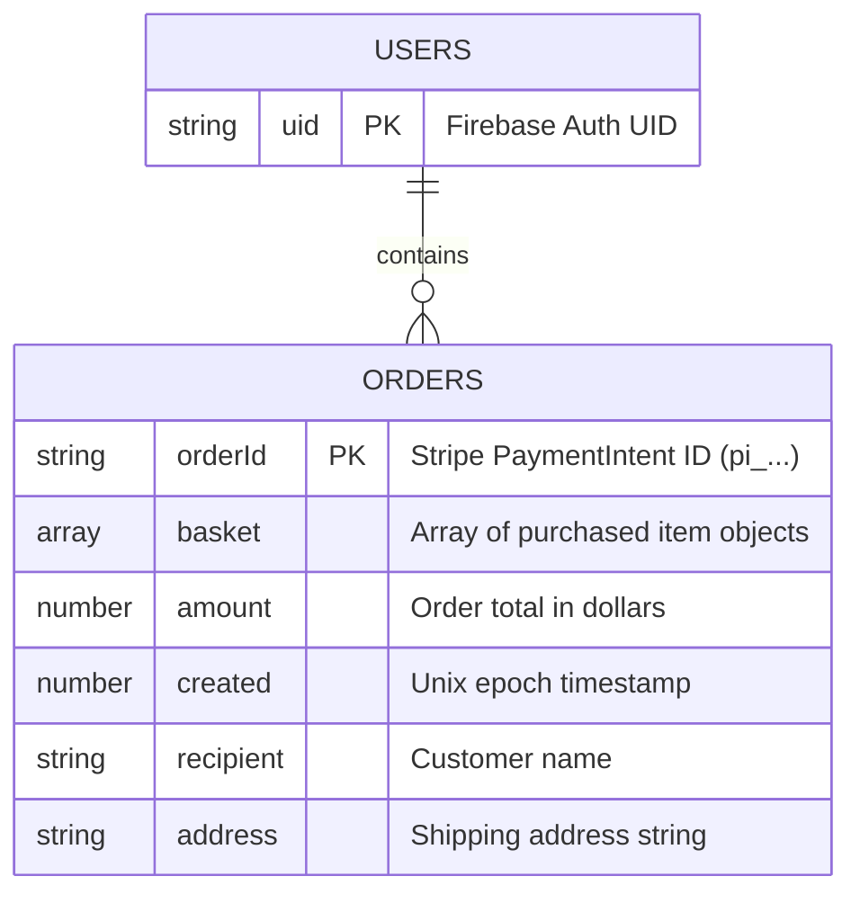

# Amazon Full-Stack Clone — Complete Developer Documentation & Architecture Guide

> **Author**: Engineering Mentorship & Documentation  
> **Repository**: [AMAZON-clone](https://github.com/mesudamin/AMAZON-clone)  
> **Target Audience**: Junior Full-Stack Developers, Maintainers, Code Reviewers  
> **Last Verified**: October 2026

---

## Table of Contents
1. [Project Overview & Technology Stack](#1-project-overview--technology-stack)
2. [System Architecture & Visual Diagrams](#2-system-architecture--visual-diagrams)
3. [Project Directory & File Responsibility Map](#3-project-directory--file-responsibility-map)
4. [Detailed Component & Module Reference](#4-detailed-component--module-reference)
5. [End-to-End Data Flow & Sequence Diagrams](#5-end-to-end-data-flow--sequence-diagrams)
6. [Backend & REST API Reference](#6-backend--rest-api-reference)
7. [Database & Persistence Architecture](#7-database--persistence-architecture)
8. [Global State Management (Context API + Reducer)](#8-global-state-management-context-api--reducer)
9. [Architectural Decisions, Patterns & Trade-offs](#9-architectural-decisions-patterns--trade-offs)
10. [Security, Vulnerability & Code Quality Audit](#10-security-vulnerability--code-quality-audit)
11. [Setup, Configuration & Maintenance Guide](#11-setup-configuration--maintenance-guide)
12. [Junior Developer Mastery & Practical Exercises](#12-junior-developer-mastery--practical-exercises)
13. [Technical Glossary](#13-technical-glossary)

---

## 1. Project Overview & Technology Stack

### 1.1 Purpose and Problems Solved
This project is an authentic, full-featured Amazon e-commerce clone built as a Single Page Application (SPA). It provides a complete e-commerce experience:
- **Product Discovery**: Dynamic catalog grid, department categorization, real-time client-side search filtering, and price/rating sorting.
- **Cart Management**: Persistent shopping cart with quantity increment/decrement, live subtotal math, item removal, and persistent browser storage.
- **User Authentication**: Secure customer registration and login with Firebase Authentication, keeping user sessions synced across tabs and reloads.
- **Checkout & Card Processing**: Two-step checkout with delivery address selection and authentic Stripe payment processing using card tokenization.
- **Order Management & Tracking**: Real-time simulated shipment timeline and historical order review.

### 1.2 Technology Stack Discovered from Code

| Layer | Technology | Version | Purpose in this Project |
| :--- | :--- | :--- | :--- |
| **Frontend Framework** | React | `^19.2.8` | Declarative component UI and virtual DOM rendering |
| **Build & Dev Tool** | Vite | `^8.3.0` | Ultra-fast development server, HMR, and Rollup bundler |
| **Routing** | React Router DOM | `^7.18.4` | Client-side declarative URL routing without full page refreshes |
| **State Management** | Context API + `useReducer` | Native React | Application-wide state for shopping basket, user profile, and orders |
| **Styling** | Vanilla CSS (BEM naming) | Pure CSS | Amazon-authentic UI styling without framework overhead |
| **UI Enhancements** | `react-responsive-carousel` | `^3.2.23` | Landing page hero banner slider |
| **UI Spinners** | `react-spinners` | `^0.17.1` | Loading feedback during network and payment requests |
| **HTTP Client** | Axios & Fetch API | Axios `^1.20.0` | Communicating with the Express backend and FakeStore API |
| **Authentication** | Firebase Auth Client SDK | `^13.0.0` | User account creation, password login, and auth state observer |
| **Database** | Cloud Firestore | `^13.0.0` | Document-based cloud backup for customer orders |
| **Payment Client** | `@stripe/react-stripe-js` | `^7.0.0` | Stripe Elements iframe UI (`CardElement`) |
| **Backend Runtime** | Node.js | `>=18.0.0` | Server-side JavaScript execution environment |
| **Backend Framework**| Express | `^5.3.0` | Minimalist HTTP web API server for Stripe integration |
| **Payment Server SDK**| Stripe Node SDK | `^23.0.0` | Creating Stripe `PaymentIntent` tokens with private API keys |
| **Deployment** | Vercel (Client) + Render (API) | Cloud | Static CDN hosting for Vite and Node container for Express |

---

## 2. System Architecture & Visual Diagrams

The application uses a **Decoupled Client-Server Architecture** with Third-Party Managed Cloud Services.



### Explaining the Connections

1. **Client to FakeStore API**: The frontend queries `https://fakestoreapi.com/products` directly via standard `fetch()` calls. The Express server does not proxy or store products.
2. **Client to Firebase Auth**: Login and sign-up requests travel straight from the browser to Google's Firebase Auth servers over secure HTTPS. Passwords never touch your Express backend.
3. **Client to Express Server**: During checkout, the client makes an HTTP request to `https://amazon-clone-e0n7.onrender.com/payment/create?total={cents}` using Axios.
4. **Express Server to Stripe API**: The server uses its secret key (`STRIPE_KEY`) to request a new `PaymentIntent` from Stripe and returns the unique `clientSecret` to the browser.
5. **Client to Stripe Payment Gateway**: The browser takes the `clientSecret` and customer card data entered into `CardElement` and submits it directly to Stripe. Raw credit card numbers **never touch your server or your database**.
6. **Client to Cloud Firestore**: When payment succeeds, the browser uses Firebase's `setDoc()` to record the order details under `users/{uid}/orders/{orderId}`.

---

## 3. Project Directory & File Responsibility Map

```
AMAZON/
├── package.json                    # Workspace root scripts (dev, build, start)
├── render.yaml                     # Render deployment configuration
├── .gitignore                      # Git exclusion rules (node_modules, .env)
├── client/                         # Vite + React Frontend Project
│   ├── .env                        # Local frontend environment variables
│   ├── .env.example                # Template for required frontend env variables
│   ├── index.html                  # HTML entry point with Amazon favicon & fonts
│   ├── package.json                # Frontend dependencies and scripts
│   ├── vite.config.js              # Vite configuration (React plugin, chunk limits)
│   ├── vercel.json                 # SPA rewrite configuration for Vercel
│   └── src/
│       ├── main.jsx                # React DOM entry point
│       ├── App.jsx                 # Top-level auth observer and data provider mount
│       ├── App.css                 # Global application layout CSS
│       ├── Router.jsx              # React Router route configuration
│       ├── Api/
│       │   └── axios.js            # Axios instance configured with backend baseURL
│       ├── utility/
│       │   ├── action.type.js      # Constant action strings for reducer
│       │   ├── DataContext.js      # createContext instance and custom useData hook
│       │   ├── firebase.js         # Firebase Auth & Firestore client setup + fallbacks
│       │   └── reducer.js          # Global state reducer with localStorage helpers
│       ├── components/
│       │   ├── Carousel/           # Landing page banner slider
│       │   ├── Categories/         # Department category cards
│       │   ├── DataProvider/       # React Context Provider component
│       │   ├── Footer/             # Multi-column Amazon footer
│       │   ├── Layout/             # Wrapper with Header and Footer
│       │   ├── Loader/             # Animated spinner indicator
│       │   ├── Product/            # Product catalog grid and individual ProductCard
│       │   ├── ProtectedRoute/     # Authentication guard for private routes
│       │   └── headercomponents/   # SearchBar, AccountMenu, SideMenu, LocationModal
│       └── pages/
│           ├── Auth/               # Sign-in and account registration (Firebase Auth)
│           ├── Cart/               # Cart item listing, qty controls, and subtotal
│           ├── Landing/            # Main landing page assembling banners and products
│           ├── NotFound/           # 404 error page for unmatched URLs
│           ├── Orders/             # Customer order history and package tracking
│           ├── Payment/            # Stripe Elements checkout and payment submission
│           ├── ProductDetail/      # Single product page with buy box and rating
│           └── Results/            # Search results and category department browsing
└── server/                         # Node.js + Express Backend Project
    ├── .env                        # Server secrets (STRIPE_KEY, PORT)
    ├── package.json                # Server dependencies (express, cors, stripe, dotenv)
    └── app.js                      # Express server entry point and Stripe controller
```

---

## 4. Detailed Component & Module Reference

### 4.1 State & Utilities

#### `DataContext.js` (`client/src/utility/DataContext.js`)
- **Purpose**: Creates the React Context instance and custom consumer hook.
- **Exports**: `DataContext`, `useData()`.
- **How it works**:
  ```javascript
  import { createContext, useContext } from 'react'
  export const DataContext = createContext()
  export const useData = () => useContext(DataContext)
  ```
- **Why it matters**: Any component can simply call `const [{ basket, user }, dispatch] = useData()` without prop drilling.

#### `reducer.js` (`client/src/utility/reducer.js`)
- **Purpose**: Central state logic engine. Handles state transitions and synchronizes changes to browser `localStorage`.
- **Initial State**:
  - `basket`: Loaded from `localStorage.getItem('amazon_basket')` or `[]`.
  - `user`: Loaded from `localStorage.getItem('amazon_user')` or `null`.
  - `orders`: Loaded from `localStorage.getItem('amazon_orders')` or `[]`.
- **Action Types Handled**:
  - `ADD_TO_BASKET`: If product already exists in cart, increments `quantity`; otherwise appends it with `quantity: 1`.
  - `DECREMENT_QUANTITY`: Decreases item quantity by 1; if quantity reaches 0, removes the item.
  - `REMOVE_FROM_BASKET`: Filters out the item by ID completely.
  - `EMPTY_BASKET`: Sets `basket` to `[]` after payment.
  - `SET_USER`: Updates authenticated user object or sets to `null` on logout.
  - `PLACE_ORDER`: Prepends newly placed order to `orders` array and resets `basket`.
  - `CLEAR_ORDERS`: Resets `orders` to `[]`.

#### `firebase.js` (`client/src/utility/firebase.js`)
- **Purpose**: Initializes the Firebase Web SDK.
- **Exports**: `app` (Firebase app), `auth` (`getAuth`), `db` (`getFirestore`).
- **Resilience Design**: Reads from `import.meta.env.VITE_FIREBASE_*` and includes project fallbacks so the app will never crash if environment variables are omitted on deployment.

---

### 4.2 Core Pages

#### `Landing.jsx` (`client/src/pages/Landing/Landing.jsx`)
- **Responsibility**: Home page. Assembles the hero banner carousel, category cards grid, and product catalog showcase.
- **Components Rendered**: `<CarouselEffect />`, `<Category />`, `<Product />`.

#### `ProductDetail.jsx` (`client/src/pages/ProductDetail/ProductDetail.jsx`)
- **Responsibility**: Displays individual product specs, rating breakdown, and Amazon "Buy Box".
- **Dynamic Parameter**: Reads `:productId` from the URL using `useParams()`.
- **Network Call**: `fetch('https://fakestoreapi.com/products/' + productId)`.
- **Interactive Features**:
  - Quantity dropdown selector (1 through 10).
  - "Add to Cart" button (adds selected quantity and shows toast notice).
  - "Buy Now" button (adds to cart and immediately redirects to `/payment` or `/auth`).

#### `Cart.jsx` (`client/src/pages/Cart/Cart.jsx`)
- **Responsibility**: Shows items currently in the user's cart, calculates the running total, and provides checkout navigation.
- **Key Logic**:
  ```javascript
  const totalItems = basket?.length || 0
  const totalPrice = basket?.reduce((amount, item) => item.price * item.quantity + amount, 0) || 0
  ```
- **Actions**: Calls `handleIncrement`, `handleDecrement`, and `handleRemove` via `dispatch()`.

#### `Payment.jsx` (`client/src/pages/Payment/Payment.jsx`)
- **Responsibility**: 3-step checkout page (Address selection, Stripe card input, item review).
- **Hooks Used**: `useStripe()`, `useElements()`, `useNavigate()`, `useData()`.
- **Stripe Element**: Embeds `<CardElement />` for PCI-compliant card data entry.
- **Payment Sequence**:
  1. Requests `clientSecret` from Express backend (`/payment/create?total=...`).
  2. Submits card details to Stripe using `stripe.confirmCardPayment(clientSecret, ...)`.
  3. On success, writes order to Firestore (`users/{uid}/orders/{id}`).
  4. Dispatches `PLACE_ORDER` and `EMPTY_BASKET`.
  5. Redirects to `/orders`.

#### `Orders.jsx` (`client/src/pages/Orders/Orders.jsx`)
- **Responsibility**: Displays order history, search bar to filter past purchases, "Buy it again" shortcuts, and a package tracking modal.
- **Current Data Source**: Reads from global state `orders` (persisted in `localStorage`).

#### `Auth.jsx` (`client/src/pages/Auth/Auth.jsx`)
- **Responsibility**: Handles user sign-in and new account creation with Firebase Auth.
- **Methods Used**: `signInWithEmailAndPassword`, `createUserWithEmailAndPassword`, `updateProfile`.
- **Redirect Support**: Reads `location.state?.redirect` so customers attempting to checkout are sent back to `/payment` immediately after logging in.

---

### 4.3 Navigation & Header Components

#### `Header.jsx` (`client/src/components/headercomponents/Header/Header.jsx`)
- **Responsibility**: Main Amazon navigation bar. Contains logo, delivery location selector, search bar, language switcher, account menu, orders link, and cart badge with live count.
- **Cart Badge Counter**: Reads `basket?.length` directly from `useData()` to update in real time.

#### `ProtectedRoute.jsx` (`client/src/components/ProtectedRoute/ProtectedRoute.jsx`)
- **Responsibility**: Route guard wrapper. Checks if `user` exists in global state. If not, redirects to `/auth` with a flash message and preserves the destination path.

---

## 5. End-to-End Data Flow & Sequence Diagrams

### 5.1 Adding an Item to Cart


### 5.2 Placing an Order & Payment Processing


---

## 6. Backend & REST API Reference

The backend is built with Express (`server/app.js`) and deployed on Render.

### 6.1 Server Configuration & Middleware
```javascript
const app = express();
app.use(cors({ origin: true }));  // Cross-Origin Resource Sharing
app.use(express.json());         // Parse incoming JSON request bodies
```

### 6.2 Endpoints

#### `GET /`
- **Description**: Health status and deployment verification.
- **Request Parameters**: None.
- **Response** (`200 OK`):
  ```json
  {
    "status": "online",
    "message": "Amazon Clone API Server is running successfully on Render!",
    "stripeConfigured": true,
    "timestamp": "2026-10-15T06:00:00.000Z"
  }
  ```

#### `GET /health`
- **Description**: Returns process uptime for cloud health checks.
- **Response** (`200 OK`):
  ```json
  {
    "status": "healthy",
    "uptime": 452.12
  }
  ```

#### `POST /payment/create`
- **Description**: Creates a Stripe PaymentIntent and returns the client secret.
- **Accepted Inputs**:
  - Query parameter: `?total=2500` (value in cents)
  - Body parameter: `{ "total": 2500 }` or `{ "amount": 2500 }`
- **Validation**:
  - Ensures `stripe` instance is initialized.
  - Ensures `total > 0`.
- **Success Response** (`201 Created`):
  ```json
  {
    "clientSecret": "pi_3MtwxALkdIwHu7ix28a3tqPa_secret_YrKJ..."
  }
  ```
- **Error Responses**:
  - `400 Bad Request`: `{ "message": "Total amount must be greater than 0" }`
  - `500 Internal Server Error`: `{ "error": "Stripe API key is not configured..." }`

---

## 7. Database & Persistence Architecture

### 7.1 Client-Side Persistence (`localStorage`)
The primary fast storage for the user session is the browser's `localStorage`:
- `amazon_basket`: JSON array of items currently in the cart.
- `amazon_user`: JSON object with `{ uid, email, displayName, name }`.
- `amazon_orders`: JSON array of confirmed customer orders.

### 7.2 Cloud Firestore (NoSQL Document Store)
When an authenticated customer completes a purchase, `Payment.jsx` backs up the order record into Google Cloud Firestore:



**Firestore Path**:
`/users/{user.uid}/orders/{paymentIntent.id}`

---

## 8. Global State Management (Context API + Reducer)

### 8.1 How It Works
The state architecture uses React's native `useReducer` paired with `createContext`:

```
               ┌───────────────────────┐
               │    App.jsx (Root)     │
               └───────────┬───────────┘
                           │ Wraps tree in
               ┌───────────▼───────────┐
               │     DataProvider      │
               │ [state, dispatch]     │
               └───────────┬───────────┘
                           │ Consumed by
           ┌───────────────┼───────────────┐
           ▼               ▼               ▼
     Header.jsx        Cart.jsx       Payment.jsx
   (Reads basket)   (Dispatches     (Dispatches
                     INCREMENT)      PLACE_ORDER)
```

### 8.2 What Happens on Page Refresh
1. When the page reloads, React state in memory resets to initial values.
2. `reducer.js` executes:
   ```javascript
   export const initialState = {
     basket: loadStorage('amazon_basket', []),
     user: loadStorage('amazon_user', null),
     orders: loadOrders()
   }
   ```
3. The cart items, user cache, and orders are immediately restored from `localStorage`.
4. In parallel, `App.jsx` triggers Firebase's `onAuthStateChanged()`. If Firebase verifies a valid auth token in browser storage, it dispatches `SET_USER` with the refreshed user details.

---

## 9. Architectural Decisions, Patterns & Trade-offs

### 9.1 Design Patterns in Use
1. **Reducer Pattern**: State changes are dispatched through typed actions (`Type.ADD_TO_BASKET`), keeping state transitions centralized and predictable.
2. **Provider Pattern**: `DataProvider` wraps the component tree so any component can access global state via `useData()`.
3. **Container / Presentation Pattern**: Pages (e.g. `Landing.jsx`) handle fetching and layout composition, while smaller components (e.g. `ProductCard.jsx`) focus on rendering props.
4. **Tokenized Payment Pattern**: Card numbers are handled in an isolated Stripe iframe (`CardElement`) and swapped for single-use tokens (`clientSecret`), keeping sensitive data out of custom servers.

### 9.2 Key Trade-offs & Limitations
- **FakeStore API vs. Own Product DB**: Using FakeStore API eliminated the need to build a product catalog database from scratch. However, you cannot create, edit, or track inventory for products.
- **Client-Side vs. Server-Side Cart**: Storing the cart in `localStorage` makes it instantaneous and free of database writes. However, if a user opens the site on another device, their cart does not follow them.

---

## 10. Security, Vulnerability & Code Quality Audit

### 🚨 Finding 1: Client Controls Transaction Pricing (Critical)
- **File**: `client/src/pages/Payment/Payment.jsx` (lines 87–91) and `server/app.js` (line 52)
- **Evidence**:
  ```javascript
  // Payment.jsx
  const totalInCents = Math.round(orderTotal * 100);
  await axiosInstance.post(`/payment/create?total=${totalInCents}`);

  // server/app.js
  const total = parseInt(req.query.total || req.body?.total, 10);
  await stripe.paymentIntents.create({ amount: total, currency: 'usd' });
  ```
- **Risk**: A customer can intercept the HTTP request or use Postman to send `total=1` (1 cent) and complete checkout for high-value items.
- **Fix**: The client should only send product IDs and quantities: `{ items: [{ id: 1, quantity: 2 }] }`. The server must look up prices in a trusted database and calculate the total itself.

---

### ⚠️ Finding 2: Unauthenticated Payment API (High)
- **File**: `server/app.js` (line 44)
- **Risk**: `/payment/create` has no authentication check. Anyone on the internet can spam the endpoint and generate thousands of pending PaymentIntents on your Stripe account.
- **Fix**: Require a Firebase ID token in the `Authorization: Bearer <token>` header and verify it on the server with `firebase-admin`.

---

### ⚠️ Finding 3: Orders Screen Does Not Read from Cloud Firestore (High)
- **File**: `client/src/pages/Orders/Orders.jsx` (line 12)
- **Evidence**: `Orders.jsx` reads `const [{ orders }] = useData()` which only loads from `localStorage`.
- **Risk**: If a customer clears their browser cache or logs in on a new device, their orders disappear from the screen, even though they were saved in Firestore.
- **Fix**: Add a `useEffect` in `Orders.jsx` to fetch orders from `users/{uid}/orders` in Firestore when the page mounts.

---

### 🟡 Finding 4: Side-Effects Inside Reducer (Medium)
- **File**: `client/src/utility/reducer.js` (lines 60, 82, 91, etc.)
- **Evidence**: `saveStorage('amazon_basket', updatedBasket)` is called directly inside reducer switch cases.
- **Risk**: Reducers should be pure functions with no side effects. Calling `localStorage` inside the reducer makes testing difficult and can cause duplicate disk writes.
- **Fix**: Move `localStorage.setItem` into a `useEffect` inside `App.jsx` that watches `state.basket`.

---

### 🟡 Finding 5: Permissive CORS (Medium)
- **File**: `server/app.js` (line 22)
- **Evidence**: `app.use(cors({ origin: true }))`
- **Risk**: Allows any website on the internet to call your API.
- **Fix**: Restrict allowed origins:
  ```javascript
  app.use(cors({
    origin: ['https://your-amazon-clone.vercel.app', 'http://localhost:5173']
  }));
  ```

---

## 11. Setup, Configuration & Maintenance Guide

### 11.1 Local Installation

#### 1. Clone the Repository
```bash
git clone https://github.com/mesudamin/AMAZON-clone.git
cd AMAZON-clone
```

#### 2. Install Dependencies
```bash
# Install server dependencies
cd server
npm install

# Install client dependencies
cd ../client
npm install
```

### 11.2 Environment Variables

#### Client Configuration (`client/.env`)
Create `client/.env` based on `client/.env.example`:
```env
# Backend API URL (Use localhost for local server testing)
VITE_API_URL=https://amazon-clone-e0n7.onrender.com

# Stripe Publishable Key
VITE_STRIPE_PUBLIC_KEY=pk_test_...

# Firebase Web App Credentials
VITE_FIREBASE_API_KEY=AIzaSy...
VITE_FIREBASE_AUTH_DOMAIN=your-app.firebaseapp.com
VITE_FIREBASE_PROJECT_ID=your-project-id
VITE_FIREBASE_STORAGE_BUCKET=your-app.firebasestorage.app
VITE_FIREBASE_MESSAGING_SENDER_ID=123456789
VITE_FIREBASE_APP_ID=1:123456789:web:abcdef
```

#### Server Configuration (`server/.env`)
Create `server/.env`:
```env
PORT=5000
STRIPE_KEY=sk_test_your_secret_stripe_key_here
```

### 11.3 Running Locally
```bash
# Terminal 1: Start Backend Server
cd server
npm run dev

# Terminal 2: Start Frontend Dev Server
cd client
npm run dev
```
Open `http://localhost:5173` in your browser.

---

## 12. Junior Developer Mastery & Practical Exercises

To master this codebase and prepare for technical interviews, practice these three exercises:

### Exercise 1: Eliminate Reducer Side-Effects
- **Goal**: Make `reducer.js` a 100% pure function.
- **Task**:
  1. Remove all `saveStorage(...)` lines from `reducer.js`.
  2. Open `client/src/App.jsx`.
  3. Add a `useEffect` that listens to `basket` and saves to `localStorage`:
     ```javascript
     useEffect(() => {
       localStorage.setItem('amazon_basket', JSON.stringify(basket))
     }, [basket])
     ```

### Exercise 2: Connect Orders to Cloud Firestore
- **Goal**: Ensure orders appear on any computer.
- **Task**:
  1. In `client/src/pages/Orders/Orders.jsx`, import `collection`, `query`, `orderBy`, `onSnapshot` from `firebase/firestore`.
  2. In a `useEffect`, query Firestore:
     ```javascript
     useEffect(() => {
       if (user?.uid) {
         const q = query(
           collection(db, 'users', user.uid, 'orders'),
           orderBy('created', 'desc')
         );
         const unsubscribe = onSnapshot(q, (snapshot) => {
           setFirestoreOrders(snapshot.docs.map(doc => ({ id: doc.id, ...doc.data() })));
         });
         return () => unsubscribe();
       }
     }, [user]);
     ```

### Exercise 3: Server-Side Total Calculation
- **Goal**: Prevent users from editing prices in DevTools.
- **Task**:
  1. Update `server/app.js` to accept `{ items: [...] }`.
  2. On the server, compute:
     ```javascript
     const total = items.reduce((sum, item) => sum + (item.price * item.quantity), 0);
     ```
  3. Create the Stripe PaymentIntent using this verified server sum.

---

## 13. Technical Glossary

- **SPA (Single Page Application)**: A web app that loads a single HTML file and dynamically rewrites page content with JavaScript as the user navigates, avoiding full browser reloads.
- **Context API**: React's built-in mechanism for sharing state across the entire component tree without manually passing props through every intermediate component.
- **Reducer**: A function that takes the current state and an action, and calculates the next state: `(state, action) => newState`.
- **PaymentIntent**: A Stripe object that tracks the lifecycle of a customer payment from creation through authorization and capture.
- **Client Secret**: A unique key generated by Stripe on your server that gives your frontend temporary permission to complete a specific payment.
- **NoSQL Document Store**: A database (like Firestore) that stores data in flexible, JSON-like documents grouped into collections, rather than rigid tabular rows and columns.
- **CORS (Cross-Origin Resource Sharing)**: A browser security rule that restricts web pages from making HTTP requests to a different domain than the one that served the web page.
- **PCI Compliance**: Security standards required for businesses that handle credit card data. Using Stripe Elements ensures raw card details never touch your server, fulfilling PCI compliance automatically.
